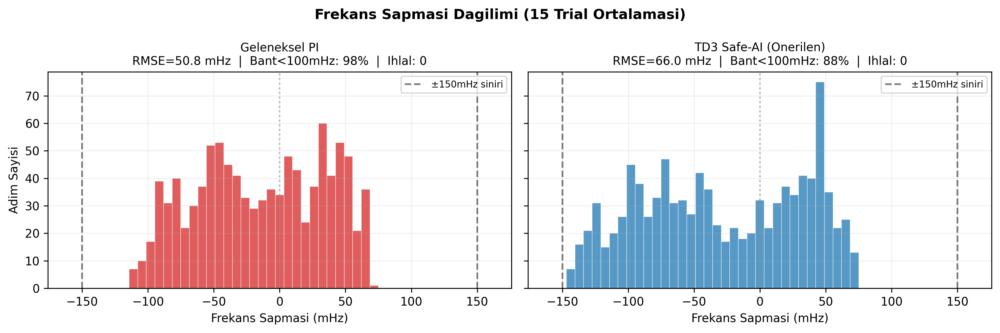

# Rüzgâr Ağırlıklı Mikro Şebekede BESS ile Frekans Kontrolü: TD3/SAC + Güvenlik Kalkanı

İzole bir mikro şebekede batarya enerji depolama sisteminin (BESS) güç komutunu derin pekiştirmeli öğrenme
(TD3, SAC) ile üreten ve bir PI **güvenlik kalkanı** ile koruyan kontrolcünün, **iyi ayarlanmış** klasik
kontrolcülerle (Droop, PI, PID) **aynı senaryolar üzerinde, eşleştirilmiş istatistikle** karşılaştırılması.

Bu depodaki her sonuç sayısı koddan üretilir: tablo `python evaluate.py --update-readme` ile bu dosyaya yazılır,
`python scripts/check_goal.py` tablonun `results/results.json` ile birebir aynı olduğunu denetler.

---

## Önceki sürüm hakkında not

Projenin ilk sürümü (`main` dalı, `9524ce6`) "%21,5 enerji tasarrufu, 5,6 kg CO₂, %93,4 otonomi" bildiriyordu.
Yeniden yazımdan önce o kodu kendi modeliyle yeniden çalıştırdığımızda **%8,5 tasarruf ve %87,8 otonomi** çıktı
(`results/before_refactor.txt`). Ayrıca o sürümde sonuçları geçersiz kılan yapısal sorunlar vardı:

- Gözlem `Δf/0.2` ile ölçeklenip kontrolcülerde `×0.3` ile geri çevriliyordu; kalkan 150 yerine 100 mHz'de açılıyordu.
- 2226 saatlik rüzgâr verisi 100 saniyeye sıkıştırılmıştı (bir adım ≈ 2,2 saat).
- Test profili eğitimde de görülen serinin bir parçasıydı; PI ve TD3 aynı denemede farklı gürültü görüyordu.
- "Tasarruf", frekansın daha çok sapmasına izin verilmesinden geliyordu (RMSE 51 → 61 mHz); CO₂ iddiası
  batarya enerji geçişini emisyonla karıştırıyordu.

Bu sürüm modeli, senaryoları, referans kontrolcüleri ve değerlendirmeyi baştan kurar.

---

## Model

Küçük sinyal, per-unit model (S_taban = 10 MW, f₀ = 50 Hz). Bütün değişkenler bölüm başındaki denge noktasından
sapmadır. Kontrol edilen tek büyüklük BESS güç komutu `u`'dur.

```
dΔf/dt    = (ΔP_m + P_ess + ΔP_rüzgâr − ΔP_yük − D·Δf) / (2H)       salınım denklemi
dΔP_g/dt  = (−ΔP_g − Δf/R + ΔP_c) / T_g                              dizel governor (droop)
dΔP_m/dt  = (−ΔP_m + ΔP_g) / T_t                                     dizel türbin
dΔP_c/dt  = −K_agc · (β·Δf − P_ess),   β = D + 1/R                   dizel yavaş AGC
dP_ess/dt = (−P_ess + u) / T_ess                                     BESS dönüştürücü gecikmesi
```

AGC'deki `−P_ess` terimi kalıcı dengesizliği dizele devreder: frekansı sıfırlayan her kontrolcüde batarya gücü de
sıfıra döner. Böylece batarya enerjisi yalnızca geçici rejimde harcanır ve **frekans kalitesi ↔ batarya kullanımı**
gerçek bir ödünleşim olur.

Doğrusal kısım 0,1 s adımla **sıfırıncı mertebe tutucu (ZOH) ile kesin** ayrıklaştırılır (`scipy.linalg.expm`);
`T_g = 0,1 s` iken açık Euler kararsızdır. Doğrusal olmayan kısıtlar (güç sınırı, hız sınırı, SOC sınırları,
tek yön verim) her adımda girişte uygulanır. Model doğrulaması: [`docs/MODEL_VALIDATION.md`](docs/MODEL_VALIDATION.md).

### Parametreler (`config.py`)

| Grup | Parametre | Değer |
|---|---|---|
| Şebeke | H, D, R | 2,0 s · 1,0 pu/pu · 0,05 pu/pu |
| | T_g, T_t, K_agc | 0,1 s · 0,4 s · 0,1 1/s |
| | Kontrol adımı | 0,1 s |
| BESS | Güç sınırı, hız sınırı | 0,2 pu (2 MW) · 2,0 pu/s |
| | T_ess, kapasite, verim | 0,1 s · 0,5 MWh · %95 (tek yön) |
| | SOC sınırları | 0,1 – 0,9 |
| Kalkan | Devreye girme / bırakma | \|Δf\| > 200 mHz / \|Δf\| < 100 mHz ve en az 1 s aktif |
| | PI kazançları, ceza | k_p = 5, k_i = 2 · adım başına 0,5 |
| Ödül | w_f, w_u, w_j, w_soc | 1,0 · 0,1 · 0,5 · 0 |

### Senaryolar

EPİAŞ saatlik rüzgâr üretim verisi (20.11.2025 – 20.02.2026, 2226 saat) **kronolojik** bölünür:
ilk %70 eğitim, son %30 test. Saatlik veri yalnızca **çalışma noktasını** (rüzgâr seviyesi) belirler;
saniye ölçekli değişim sentetiktir. Her 150 s'lik bölümde:

- rüzgâr türbülansı: Ornstein–Uhlenbeck süreci (zaman sabiti 5 s, ortalama seviyenin %4'ü), rüzgâr kurulu gücü 0,4 pu;
- %30 olasılıkla 20–40 s süren rüzgâr rampası;
- 1–3 adet yük adımı (±0,02–0,10 pu, aralarında en az 15 s) ve yük gürültüsü;
- başlangıç SOC'si 0,3 – 0,7 arasında.

### Kontrolcüler

| Ad | Açıklama |
|---|---|
| NoBESS | Batarya yok (alt sınır) |
| Droop | `u = −k·Δf` |
| PI | Anti-windup'lı PI |
| PID | Türevi ölçümden (ROCOF) alınan PID |
| TD3+Shield | TD3 ajanı + PI güvenlik kalkanı (eğitim ve değerlendirmede aynı sarmalayıcı) |
| SAC+Shield | SAC ajanı + aynı kalkan |
| TD3 | Kalkansız eğitilmiş ve kalkansız değerlendirilen TD3 (ablasyon) |

Klasik kontrolcülerin kazançları, RL ile **aynı maliyet fonksiyonu** için eğitim senaryolarında Optuna ile
ayarlanır (`tune_baselines.py`). Bütün kontrolcüler aynı aktüatör sınırlarından geçer.

**Gözlem (5 boyut, [−1, 1]):** Δf, ROCOF, ∫Δf dt, P_ess, SOC − 0,5.
**Ödül:** `r = −(w_f·(Δf/0,1 Hz)² + w_u·(P_ess/P_max)² + w_j·(Δu/P_max)² + w_soc·((SOC−0,5)/0,5)²)`,
kalkan aktifken ayrıca −0,5. Metrikler bu cezayı **içermeyen** görev maliyetiyle hesaplanır; kalkan etkinliği
ayrıca "ajan özerkliği" olarak raporlanır.

---

## Değerlendirme protokolü

- Test bölmesinden sabit tohumlu **40 senaryoluk banka**; her kontrolcü **birebir aynı** senaryoları çalıştırır.
- RL için 3 eğitim tohumu: senaryo başına metrik tohumlar üzerinden ortalanır, tohum bazlı özet ayrıca saklanır.
- Özet: ortalama ± standart sapma ve ortalamanın bootstrap %95 güven aralığı.
- Karşılaştırma: RL kontrolcüsü ile PI / PID arasında senaryo bazında eşleştirilmiş Wilcoxon işaretli sıra testi
  (`results/results.json` → `comparisons`).

## Sonuçlar

<!-- RESULTS:START -->
<!-- RESULTS:END -->

<!-- YORUM -->

### Şekiller

| Şekil | İçerik |
|---|---|
|  | **Şekil 1** — Örnek senaryoda Δf ve BESS gücü |
|  | **Şekil 2** — İlk yük adımı çevresinde yakınlaştırma |
|  | **Şekil 3** — Tüm test senaryolarında Δf dağılımı |
|  | **Şekil 4** — Kümülatif BESS enerji geçişi ve SOC |
|  | **Şekil 5** — Kalkan etkinlik şeridi |
|  | **Şekil 6** — Frekans RMSE ↔ BESS enerji geçişi: PI kazanç taraması ve kontrolcüler |
|  | **Şekil 7** — Özet tablo |

---

## Yeniden üretim

Python 3.11, yalnızca CPU. Sürümler `requirements.txt`'te sabitlenmiştir.

```bash
conda create -n rwfc python=3.11 -y && conda activate rwfc
pip install torch --index-url https://download.pytorch.org/whl/cpu
pip install -r requirements.txt

pytest -q                                            # 69 test (kabul testleri dahil)
python scripts/validate_model.py                     # model doğrulama tablosu
python tune_baselines.py                             # → results/baseline_gains.json, results/pareto_pi.json
for s in 0 1 2; do
  python train.py --algo td3 --seed $s --steps 150000
  python train.py --algo sac --seed $s --steps 150000
done
python train.py --algo td3 --seed 0 --steps 150000 --no-shield
python evaluate.py --update-readme                   # → results/, figures/, bu dosyadaki tablo
python scripts/check_goal.py                         # tamamlanma koşullarını denetler
```

Bir eğitim koşusu Ryzen 5 5500'de tek iş parçacığıyla yaklaşık 30–40 dakika sürer; koşular paralel çalıştırılabilir.
TensorBoard günlükleri `logs/` altındadır.

## Depo yapısı

```
config.py                  tüm parametreler, senaryo tipi, kontrolcü adları (tek doğruluk kaynağı)
envs/dynamics.py           durum-uzayı modeli ve ZOH ayrıklaştırma
envs/microgrid_lfc_env.py  Gymnasium ortamı
envs/scenarios.py          senaryo üretimi ve sabit tohumlu senaryo bankası
agents/shield.py           histerezisli PI güvenlik kalkanı (gym.Wrapper)
agents/baselines.py        NoBESS, Droop, PI, PID ve RL sarmalayıcısı
utils/                     veri yükleyici, rollout, metrikler, grafikler, rapor
train.py                   TD3 / SAC eğitimi
tune_baselines.py          referans kazanç ayarı ve PI Pareto taraması
evaluate.py                eşleştirilmiş değerlendirme, results.json, şekiller
scripts/                   model doğrulama ve hedef denetleyici
docs/                      SPEC (arayüz sözleşmesi), model doğrulama, görevler, hedef
tests/acceptance/          kabul testleri
```

## Sınırlılıklar

- **Zaman ölçeği:** EPİAŞ verisi saatliktir; saniye ölçekli rüzgâr türbülansı ve yük adımları sentetiktir.
  Saatlik veri yalnızca rüzgâr seviyesini (türbülans genliğini) belirler.
- **Normalizasyon:** rüzgâr seviyeleri bölmeden önce tüm serinin en büyük değerine bölünür; bu değer test
  bölmesindedir (eğitim bölmesinin en büyüğü 0,976). Etkisi türbülans genliğinde %2,5'ten küçüktür.
- **Model:** tek alanlı, doğrusal küçük sinyal modeli; dizel için tek governor–türbin çifti; BESS'te yaşlanma ve
  sıcaklık modellenmemiştir. Sonuçlar bu parametre kümesine bağlıdır.
- **Kalkanlı öğrenme:** kalkan devredeyken SB3'ün tekrar arabelleğine ajanın kendi aksiyonu kaydedilir, uygulanan
  PI aksiyonu değil. Ajan kalkanı tetikleyen durumlardan cezayla kaçınmayı öğrenir, ama bu geçişlerdeki Q değerleri
  uygulanan aksiyonu yansıtmaz.
- **Hiperparametreler:** RL hiperparametreleri için arama yapılmamıştır (SB3 varsayılanlarına yakın, CPU'ya uygun
  değerler); klasik kontrolcüler ise ayarlanmıştır. Bu karşılaştırma RL aleyhine bir eğilim taşıyabilir.
- **Eğitim bütçesi:** tohum başına 150 bin adım (100 bölüm).

## Kaynaklar

- Fujimoto, S., van Hoof, H., Meger, D. (2018). *Addressing Function Approximation Error in Actor-Critic Methods*. ICML.
- Haarnoja, T., Zhou, A., Abbeel, P., Levine, S. (2018). *Soft Actor-Critic*. ICML.
- Alshiekh, M. vd. (2018). *Safe Reinforcement Learning via Shielding*. AAAI.
- Kundur, P. (1994). *Power System Stability and Control*. McGraw-Hill.
- ENTSO-E, *Network Code on Load-Frequency Control and Reserves* (2017).
- EPİAŞ Şeffaflık Platformu — gerçek zamanlı üretim verisi: [epias.com.tr](https://www.epias.com.tr)
- [Stable-Baselines3](https://github.com/DLR-RM/stable-baselines3) · [Gymnasium](https://gymnasium.farama.org/)

## Lisans

Akademik ve eğitim amaçlı kullanım içindir.

**Yazar:** Efe Ağlamazlar · [github.com/aglamazlarefe](https://github.com/aglamazlarefe)
